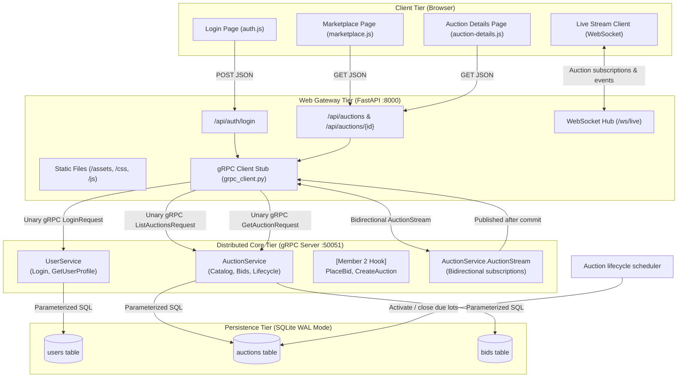

# Architecture & Communication Flow

This document details the distributed communication topology and request-response lifecycles of the **Online Auction System**.

---

## 1. End-to-End System Diagram

---

## 2. Unary RPC Request-Response Cycles

### User Login Sequence (`UserService.Login`)
1. User clicks or types username on `login.html`.
2. Browser `fetch('/api/auth/login', { username })` sends JSON to FastAPI Web Gateway.
3. Web Gateway invokes `user_stub.Login(LoginRequest(username=username))`.
4. gRPC server receives `LoginRequest`, executes `UserRepository.find_user_by_username(username)`.
5. SQLite returns user record (`user_id`, `display_name`, `role`).
6. gRPC server returns `LoginResponse` containing user profile and role.
7. Web Gateway transforms response to HTTP JSON 200 (or HTTP 404 with error message).
8. Browser stores session in `localStorage` and updates header navigation controls.

### Marketplace Catalog Query (`AuctionService.ListAuctions`)
1. Browser loads `marketplace.html` or user changes category chip / search query.
2. Browser calls `GET /api/auctions?category=Paintings&status=ACTIVE`.
3. Web Gateway calls `auction_stub.ListAuctions(ListAuctionsRequest(...))`.
4. gRPC server executes `AuctionQueryRepository.find_auctions(...)` with dynamic parameterized SQL.
5. SQLite returns matching rows and computed aggregates (`total_bids`, `min_next_bid`).
6. gRPC server packages rows into `repeated Auction` protobuf messages.
7. Web Gateway serializes list to JSON.
8. Browser renders responsive cards and starts local countdown tickers.

## 3. Live Auction Events

The browser opens `/ws/live` for an auction-details page and sends `subscribe` or
`unsubscribe` messages containing an auction ID. The FastAPI gateway bridges that
WebSocket to the native bidirectional `AuctionService.AuctionStream` RPC. The gRPC
server sends an initial auction snapshot and routes subsequent events only to streams
subscribed to that auction.

Accepted-bid events are published only after `BiddingRepository.place_bid` commits
the bid and updated auction record. Manual and automatic closure events are emitted
only for the first successful close. The browser reloads authoritative auction state
through the REST endpoint after receiving an event; WebSocket payloads do not become
a second source of auction state. If the stream disconnects, the browser reconnects
and refreshes that REST snapshot while the existing polling fallback remains active.

## 4. Auction Lifecycle and Recovery

The gRPC server runs a lifecycle sweep at startup and periodically while running.
Auctions whose stored deadlines have passed are closed through the same
`BiddingRepository.close_auction` method used by manual closure. Upcoming auctions
are activated when their stored start time arrives. The auction status, highest
accepted bid, and winner remain in SQLite, so restart recovery does not reset
deadlines or create a separate result record. Bids are rejected by the bidding
repository after the auction is closed or its deadline has passed.
